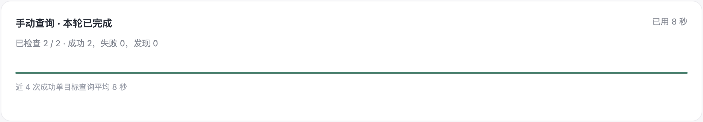

# 红薯雷达 · Rednote Watchdesk

在电脑上运行的小红书账号监测工具。每个目标可以填写多个候选小红书号，任一候选命中后就停止搜索同组其他候选。命中后可发送飞书通知，也可用选定的账号自动关注。


## 快速开始

需要 Python 3.10+、Google Chrome 和桌面环境。主要在 macOS 上验证，Linux 可手动启动。

```sh
git clone https://github.com/CBOSSX/rednote-watchdesk.git
cd rednote-watchdesk
./setup.sh
./run.sh
```

打开 http://127.0.0.1:8767

1. 在「登录账号」添加账号并扫码登录。在「搜索账号顺序」加入账号，排好优先级后保存。
2. 在「监控目标」添加目标和候选小红书号。如需自动关注，在目标卡片里选择执行账号，然后保存配置。
3. 在「轮询与通知」调整查询间隔。需要飞书通知时，填写自定义机器人的 Webhook，保存后发送测试卡片。

点击页面右上角「立即查询一次」可跳过轮询间隔和重试等待，执行一轮已保存的配置；只查询尚未完成的候选，命中后按配置通知和自动关注。暂停时也可使用，执行后仍保持暂停；平台要求验证或限制访问时仍会停止。运行中无法重复提交，结束后显示本轮成功、失败和发现数量。

页面顶部始终保留查询进度区，没有记录时显示等待状态；运行时明确标注「自动查询」或「手动查询」，并显示当前目标、搜索账号、执行阶段、完成数量和已用时间。某阶段等待过长时会提示，成功单目标查询积累后会显示最近 20 轮中的平均耗时。点击暂停会立即停止后续调度，当前步骤安全收尾，不需要等待浏览器执行锁释放。

查询结束后只保留本轮检查数量、成功/失败/发现统计和耗时，当前目标与搜索账号会隐藏。页面标识与浏览器 Tab 图标共用同一份 SVG。

<details>
<summary>查看查询汇总、账号管理与关注选择（演示数据）</summary>




</details>

监测期间请保持电脑开机、联网，并保持系统用户登录。发现时间取决于轮询间隔、小红书的搜索收录和平台限制。

查询失败时，目标卡片会显示失败阶段、连续失败次数和下次重试时间。页面正文读取超时会再等待一次（先等 5 秒，再等 10 秒）；仍失败则按 5、10、20、30 分钟退避重试。登录失效会切换可用备用账号，安全验证、IP 风险或平台限流会暂停查询，处理后再恢复。连续三轮失败及恢复成功时可发送飞书通知；本地诊断记录保留 HTTP 状态、阶段耗时、页面就绪状态和本次截图关联。

## macOS 后台运行

想让程序在登录 macOS 后自动运行，可先退出手动启动的 `./run.sh`，再安装后台服务。之后直接打开本机页面即可。

```sh
.venv/bin/python -m scripts.install_macos
```

安装器为网页和浏览器查询服务使用 `Interactive` 进程类型，避免 macOS 的 `Background` 资源限制拖慢 Chrome；看门狗仍使用 `Background`。已安装的旧版本可重新执行安装命令更新服务配置。

卸载服务会保留本地数据。

```sh
.venv/bin/python -m scripts.install_macos --uninstall
```

## 本地数据

配置、运行记录和账号登录信息保存在仓库外。请勿分享或提交这些目录。

- macOS · `~/Library/Application Support/RednoteWatchdesk/`
- Linux · `$XDG_DATA_HOME/rednote-watchdesk/`，默认是 `~/.local/share/rednote-watchdesk/`

[MIT 协议](LICENSE)
