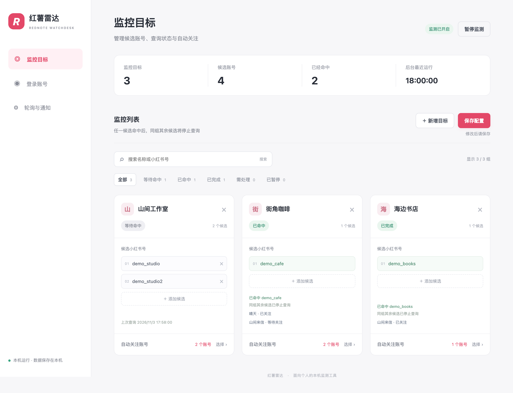
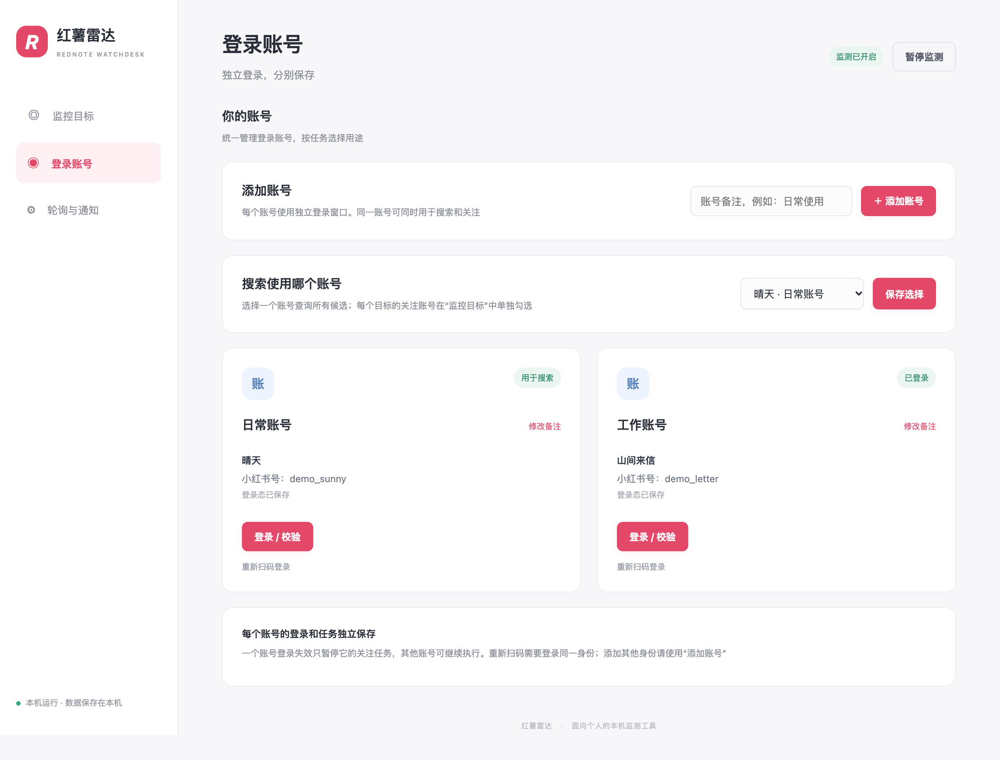
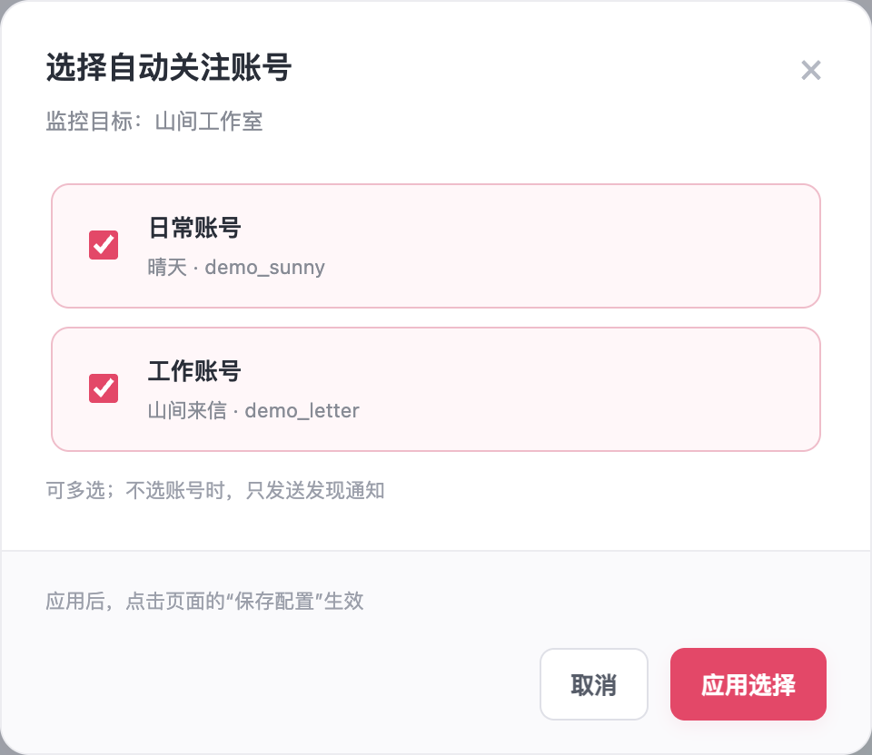

# 红薯雷达 · Rednote Watchdesk

一个在自己电脑上运行的小红书账号监测工具。通过本机页面配置监控目标、多个候选账号和自动关注，无需编辑 JSON。

**一个目标，多个候选小红书号。** 任意一个精确命中，就停止搜索同组其余候选。各组独立选择只通知，或让选中的多个账号分别自动关注。



*截图使用虚构的账号和任务状态，不代表真实登录、查询或关注结果。点击图片可查看原图。*

## 能做什么

- 按组管理多个候选小红书号，按填写顺序查询，精确匹配，忽略大小写。
- 每个目标独立勾选零个、一个或多个关注账号；不选时只通知。命中后只处理匹配的目标，每个执行账号分别保存进度和重试记录。
- 竖版候选卡片支持逐条添加、删除候选；可按名称或小红书号搜索，并按等待命中、已命中、已完成、需处理、已暂停筛选。
- 页面切换淡入滑动，筛选与删除后卡片平滑重排，新增目标/候选、通知输入框展开及提示消息都有轻量过渡。支持系统“减少动态效果”，快速连续切换也不会丢失未保存的输入。
- 统一账号列表可保存最多 20 个账号，每个账号使用独立 Chrome 配置和扫码登录窗口。选择一个账号搜索所有候选；同一账号也可执行关注任务。
- 页面调整轮询间隔、暂停/恢复监测、配置飞书/Lark 自定义机器人及 @ 提醒对象。进行中的操作显示在对应页面，完成结果显示约 8 秒后消失，不再在账号页堆积通知测试历史。
- 统一 Card 2.0 通知：发现、重试、暂停、恢复、关注成功或失败。
- 持久化查询、关注和通知队列。点击关注前保存记录，重启后只核对状态，通知重试不重复关注。
- macOS 用户级后台服务和独立看门狗；电脑重新登录后自动恢复调度。

## 快速开始

需要 **Python 3.10+、已安装的 Google Chrome**，以及可显示 Chrome 窗口的桌面环境。macOS 是主要支持和验证的平台；Linux 可手动运行本机服务，尚未在 Linux 桌面验证扫码和关注；Windows 暂未适配。

```sh
git clone https://github.com/CBOSSX/rednote-watchdesk.git
cd rednote-watchdesk
./setup.sh
./run.sh
```

打开 **http://127.0.0.1:8767**。

1. 在“登录账号”填写备注添加账号，点击“登录 / 校验”扫码；已有账号可点击“修改备注”自定义名称，备注不会改变小红书昵称、登录身份或已配置的任务。可添加多个账号，并从下拉框选择一个搜索账号，点击“保存选择”。
2. 在“监控目标”填写目标与候选小红书号，点击卡片底部的“选择”，在弹窗中勾选执行账号并点击“应用选择”，可多选；不选时只通知。弹窗不会拉长卡片，取消或按 Esc 会放弃本次勾选。
3. 在“轮询与通知”设置间隔、飞书 webhook 及 @ 对象，然后发送测试卡片。
4. 点击“监控列表”右上角的“保存配置”，与“新增目标”并列。滚动列表时操作栏保持可见，手机端两按钮并排显示。保持电脑开机、联网且用户已登录。

<details>
<summary>查看账号管理与关注选择界面（演示数据）</summary>

**账号管理：** 选择搜索账号，并通过“修改备注”自定义账号名称。



**关注选择：** 在独立弹窗里多选账号，卡片高度不变。



</details>

未配置飞书时，发现和关注结果仍保存在本机，通知等待配置后补发。自定义机器人无法仅凭姓名 @ 人，需要有效的 Open ID / User ID，且对方是通知群成员。首次使用时填写自己的 webhook；未开启签名校验时无需填写签名密钥。已配置的地址和密钥显示为“已保存”状态，不回显真实内容；点击“更换”才会打开输入框。支持分别清除 Webhook、签名密钥，也可以清除全部通知配置（包含 @ 对象）。清除 Webhook 后暂停发送，待发送消息保留，重新配置后补发。

## 安装 macOS 后台服务

```sh
.venv/bin/python -m scripts.install_macos
```

安装三个用户级启动项：监测调度、独立看门狗、配置页面。监测调度每分钟判断是否到期；看门狗每 5 分钟检查一次。配置页面只监听 `127.0.0.1`。

卸载后台服务（保留个人数据）：

```sh
.venv/bin/python -m scripts.install_macos --uninstall
```

手动运行 `./run.sh` 默认自带调度，不需要同时安装后台服务。已安装后台服务后，直接访问本机页面即可。

旧版本安装的后台服务仍可使用根目录的兼容入口。更新代码后，需要重启配置页面服务以加载新的模块与静态资源路由（不会重启监测任务）：

```sh
launchctl kickstart -k "gui/$(id -u)/app.rednote-watchdesk.ui"
```

手动启动的实例则停止后重新运行 `./run.sh`。之后刷新浏览器即可。

## 数据和凭据放在哪里

**仓库目录只保存代码。个人运行数据位于独立目录：**

| 平台 | 默认私有目录 |
|---|---|
| macOS | `~/Library/Application Support/RednoteWatchdesk/` |
| Linux | `$XDG_DATA_HOME/rednote-watchdesk/`，默认 `~/.local/share/rednote-watchdesk/` |

该目录包含 `config.json`、`secrets.json`、`data/state.json`、账号列表（`data/accounts.json`）、各账号的登录信息/浏览器配置及日志。目录/密钥文件采用用户私有权限。不要分享或提交这个目录。

可通过环境变量 `REDNOTE_WATCHDESK_HOME` 指定其他**仓库外**目录，以运行独立实例。[配置示例](examples/config.example.json) 和 [通知示例](examples/secrets.example.json) 均为占位示例，没有真实凭据。

页面采用同源检查、Host 校验和 CSRF token，不支持直接暴露到公网。这里没有多人账号系统；每个使用者在自己的电脑运行自己的实例。

## 配置模型

页面保存的配置形如：

```json
{
  "interval_seconds": 1800,
  "search_account_id": "acct_example_search",
  "people": [
    {
      "id": "person_alice",
      "name": "Alice",
      "candidates": ["example_alice", "example_alice2"],
      "follow_account_ids": ["acct_example_search", "acct_example_second"]
    }
  ]
}
```

`search_account_id` 指定一个搜索账号；`follow_account_ids` 是每个目标的关注账号列表，空列表表示只通知。账号 ID 由页面生成，上例仅是占位符，请通过账号列表选择。`auto_follow` 为兼容字段，由关注账号列表推导。

`id` 是任务的稳定标识，页面会自动生成。命中结果及完成记录会保留；增加其他候选不会让已经命中的分组重新搜索。需要改为另一个监控任务时，删除后新增即可。已命中的候选不能直接移除；页面会给出提示。

最多 10 组，合计最多 10 个候选账号。重复或仅大小写不同的候选会被拒绝；关注账号必须逐个明确选择，不会自动加入新登录的账号。

旧版搜索账号与关注账号会显示为“原搜索账号 / 原关注账号”，直接沿用原浏览器配置。首次保存新配置后，旧关注记录归到原关注账号，不会因迁移重新点击；以后新增执行账号只为该账号创建新任务。重新扫码仍需登录同一身份，其他身份应新增账号。

保存后会唤醒调度；如果旧查询正在运行，会在本轮结束后应用。正在执行关注时，配置保存会提示稍后重试，以避免开关修改与点击关注发生冲突。

## 运行边界

- 这是轮询工具，不是注册事件推送，不能保证“注册后第一时间关注”。搜索收录延迟、设备离线和平台风控都会影响及时性。
- 普通查询错误持续退避重试；登录失效、验证码或明确风控暂停查询并提醒。
- 某个执行账号登录失效或身份不一致时，只暂停该账号的关注任务；其他执行账号继续。处理后可在该账号卡片恢复任务。搜索账号失效仍需恢复监测。已关注时不会重复点击；新关注必须刷新确认。
- 每轮最多处理两个账号关注任务，其余任务由后续轮次继续。成功记录、点击前检查点、重试次数和通知回执均按“目标 × 执行账号”独立保存；取消再勾选同一账号保留已有结果。
- 关注前的网络错误最多尝试 3 次；点击后中断只重试核对状态。成功或失败会发卡片，通知离线时按顺序补发。
- 自动化使用仍可能触发平台限制。程序不自动解决验证码，不绕过风控，不使用逆向私有接口。
- 关机、休眠或退出系统用户后不能运行。同机看门狗也无法在整机离线期间即时通知。

## 开发与验证

### 目录结构

```text
rednote-watchdesk/
├── rednote_watchdesk/        # Python 业务包
│   ├── config_server.py     # 本机 HTTP API 与静态资源白名单
│   ├── watch.py             # 查询、登录与监控流程
│   ├── watch_config.py      # 配置校验、规范化与版本签名
│   ├── group_state.py       # 分组状态迁移与完成判断
│   ├── follow.py            # 浏览器关注操作
│   ├── follow_jobs.py       # 关注队列分发与旧版兼容
│   ├── multi_follow.py      # 多账号关注执行
│   ├── follow_state.py      # 每个目标 × 账号的状态与迁移
│   ├── accounts.py          # 账号注册、身份与浏览器隔离
│   ├── cards.py             # 飞书卡片
│   ├── mentions.py          # @ 对象格式
│   ├── retry_policy.py      # 查询/关注重试策略
│   ├── tick.py              # 到期调度与心跳
│   ├── watchdog.py          # 独立看门狗
│   └── paths.py             # 代码与私有数据路径
├── web/
│   ├── index.html          # 页面与卡片模板
│   ├── js/app.js           # 编辑、筛选、请求与状态展示
│   ├── js/accounts.js      # 账号列表与多选关注控件
│   ├── js/motion.js        # 动画、布局过渡与减少动态效果
│   ├── css/style.css       # 页面样式与响应式布局
│   └── css/motion.css      # 控件、开关与提示消息过渡
├── tests/                  # 后端回归与隔离浏览器检查
├── scripts/
│   ├── install_macos.py     # macOS 后台服务安装/卸载
│   └── capture_screenshots.py # 仅用演示数据生成 README 截图
├── examples/               # 不含个人信息的配置示例
├── docs/                   # 页面截图
├── .github/workflows/      # CI
├── run.sh / setup.sh       # 日常启动与依赖安装
└── config_server.py / tick.py / watch.py / watchdog.py
                            # 仅转发到包内的旧版兼容入口
```

业务代码、测试和示例分别归档；根目录四个 Python 兼容入口不承载业务逻辑，保留它们是为了不破坏现有 LaunchAgent 和旧脚本。新代码使用 `rednote_watchdesk` 包导入；新安装的服务使用 `python -m` 启动。前端保持原生 ES modules，无需 Node 依赖或构建步骤。所有命令均在仓库根目录执行。

动画逻辑集中在 `web/js/motion.js`：切换即时更新页面状态，动画只负责视觉过渡；筛选和新增保留现有卡片节点。后台轮询不会让未变化的页面反复播放入场动画。调整动效时同时检查普通模式和系统“减少动态效果”模式。

### 回归检查

运行纯本机回归测试，不调用真实关注接口：

```sh
.venv/bin/python -m unittest discover -s tests -t . -q
```

浏览器检查（需先运行 `./setup.sh` 并安装 Google Chrome）：

```sh
.venv/bin/python -m tests.ui_smoke
```

单元测试中的小红书浏览器动作使用替身，HTTP 测试仅监听随机本机端口。界面检查使用真实无头 Chrome 和临时本机数据，覆盖添加账号、备注修改与取消、搜索账号选择、弹窗多选/取消及卡片高度保持、通知反馈归属/自动消失、快速切换、筛选、增删、隐藏草稿保存、通知输入框、移动端布局及减少动态效果；不启动监测、不登录小红书、不发送通知。CI 自动运行单元测试，浏览器检查在本机单独运行。真实关注应仅在操作者明确授权的账号上验证。

更新 README 截图：

```sh
.venv/bin/python -m scripts.capture_screenshots
```

截图脚本使用固定演示数据并拦截全部浏览器请求；不加载后台模块、不读取个人运行目录、不连接现有服务或小红书。主图和账号页保留完整页面，关注选择只截取弹窗内容。

项目以 MIT 协议发布，与小红书、飞书或 Lark 无隶属关系。
